<div align="center">

# Forge

**规范驱动的 AI 辅助开发工作流（Claude Code / Codex Skills）**

> 先充分讨论，再写文档明确需求，再基于文档设计和实现。<br>
> 无 Feature Spec 不写代码。无验收计划不跑测试。发现问题必须举一反三。

[](LICENSE)
[](https://claude.ai/code)
[]()
[](https://github.com/antonailog/forge-skills/releases)

[这是什么](#这是什么) · [快速开始](#快速开始) · [Skill 清单](#skill-清单) · [关键机制](#关键机制) · [安装](#安装) · [设计哲学](#设计哲学) · [文档导航](#文档导航)

</div>

---

## 这是什么

Forge 是一套覆盖**从头脑风暴到发布复盘完整开发链路**的 Claude Code / Codex Skills：**16 个专职 Skill + 1 个总入口 `/forge`**。既可全链路串联（`/forge-dev --full` 从需求一路编排到发布），也可单独调用任意一环（比如只用 `/forge-eng` 写代码）。

核心理念是**规范驱动开发（Spec-Driven Development）**：每个功能在写代码前必须有 Feature Spec——Given/When/Then 行为场景 + 验收检查表——经用户确认后才进入开发；QA 基于同一份 Spec 逐项断言。文档是 Skill 之间传递上下文的唯一通道，不依赖会话历史。

### 解决的核心问题

| 问题 | 没有 Forge | 有 Forge |
|------|-----------|---------|
| 讨论不足，直接开干 | 口头一说就写代码 | forge-brainstorm 多轮讨论 → 方案确认 |
| 需求模糊，验收靠人肉 | PRD 没有精确验收标准 | Feature Spec（Given/When/Then + 验收检查表）→ 用户确认后才开发 |
| QA 测不出问题 | 只测"元素存在"不测"符合设计" | 基于验收检查表逐项断言（含 CSS 属性值） |
| 反馈后不举一反三 | 报了 3 个 bug，只修 3 个 | 搜索相似模式 → 类似风险清单 → 一并修复 |
| 设计粗糙，改了又改 | 简单想法直接写 | forge-design 自闭环（竞品 + 美学 + 99 条 UX 规则 + 门控） |
| AI 长会话质量劣化 | 一个会话干到底 | 上下文工程：调度器精简，子任务独立上下文 |
| 教训不沉淀，问题复发 | 复盘写完就忘 | forge-fupan 账本 + 开工自动回放 + 复发检测 |
| 不知道下一步 | 记住所有 skill 名字 | `/forge` 检查状态，推荐下一步 |

---

## 系统全景

<p align="center">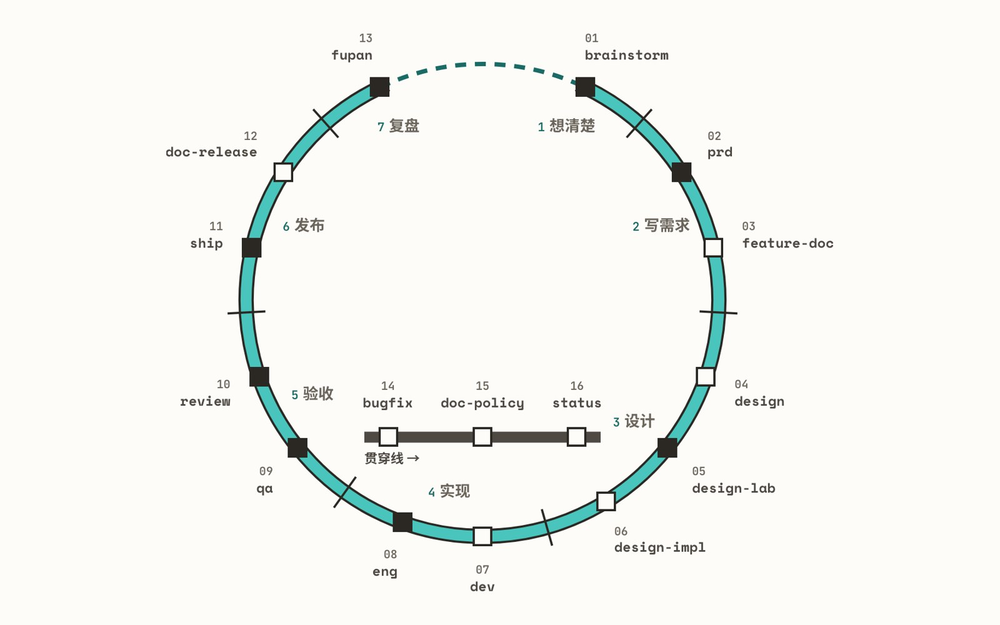</p>

<p align="center">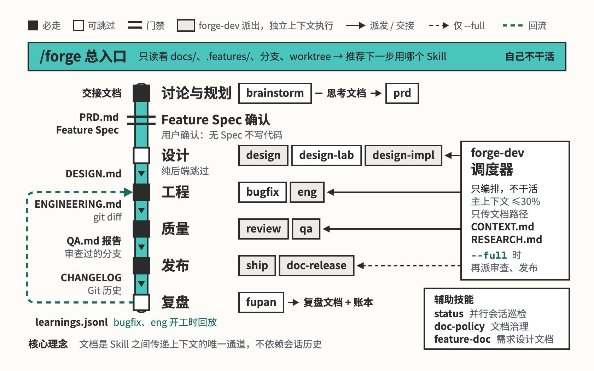</p>

```
用户有想法
       │
       ▼
  ┌─────────────────┐
  │ forge-brainstorm │  头脑风暴 → 思考文档
  └──────┬──────────┘  4 模式：产品 · 内容 · 构建 · 探索
         │
         ▼
  ┌──────────┐
  │ forge-prd│  产品诊断 → PRD 当前事实 + .features Feature Spec + CHANGELOG
  └────┬─────┘  ⚠️ Feature Spec 用户确认后才进入开发
       │
       ▼
  ┌──────────┐
  │ forge-dev│  调度器 → Discussion → Research → 子技能调度
  └────┬─────┘  --full 尾段可一路编排到发布
       │ 独立上下文执行
  ┌────┼──────────────────────┐
  ▼    ▼                      ▼
┌──────────┐ ┌──────────────┐ ┌──────────┐ ┌──────────┐
│  forge-  │ │forge-design- │ │  forge-  │ │  forge-  │
│  design  │ │    impl      │ │   eng    │ │    qa    │
└──────────┘ └──────────────┘ └──────────┘ └──────────┘
 设计规划      设计→代码        工程实现      QA 验收
 自闭环                       TDD+Worktree  验收计划→测试
                                            →举一反三
       │
       ▼
  ┌──────────┐   ┌──────────┐   ┌──────────┐
  │  forge-  │ → │  forge-  │ → │  forge-  │
  │  review  │   │   ship   │   │  fupan   │
  └──────────┘   └──────────┘   └──────────┘
   代码审查       发布流程       复盘沉淀

随时：/forge → 检查项目状态，推荐下一步
```

---

## 快速开始

**场景 A：新想法**
```
/forge-brainstorm  → 讨论想法，产出思考文档
/forge-prd         → PRD 当前事实 + .features Feature Spec（用户确认后才开发）
/forge-dev         → 调度设计 + 工程 + QA
```

**场景 B：已有 PRD**
```
/forge-dev         → 检查 Feature Spec → 调度
```

**场景 C：不知道下一步**
```
/forge             → 检查状态，告诉你该做什么
```

**场景 D：单独调用**
```
/forge-eng         → 只写代码（Worktree + TDD）
/forge-qa          → 只跑验收测试
/forge-bugfix      → 系统性修 Bug
```

**场景 E：全自动交付**
```
/forge-dev --full   → 从需求一路编排到发布（review → ship → doc-release）
/forge-dev --resume → 从检查点恢复
```
> forge-deliver 已于 2026-07-04 退役并入 forge-dev（归档在 `_archive/2026-07-04-forge-deliver-retired/`）。

**场景 F：新项目一键接入**
```
~/.claude/skills/forge-doc-policy/scripts/init-project.sh
                    → 幂等铺好 docs/、.features/、.forge/ 状态文件
```

---

## 完整示范：用 Forge 做一个番茄钟网页

从一句想法「我想做一个番茄钟网页，专心工作 25 分钟、休息 5 分钟，能看到今天完成了几个」开始，按 Forge 的流程一步步做到合并上线，中间还修了一个真实的 bug。代码、需求、设计、验收报告都在示范仓库 [forge-demo-pomodoro](https://github.com/antonailog/forge-demo-pomodoro)，每个 Skill 在这次示范里拿到了什么、做了什么、交出了什么，记在 [examples/pomodoro/](examples/pomodoro/)。

需要用户拍板的地方由 AI 按事先写好的需求设定代为确认，记录里每一处都有标注；写代码那几步由 [codex-delegate](https://github.com/antonailog/skills/tree/main/skills/codex-delegate) 派给本机 Codex 写、Claude 验收。

每张图左边是这一步拿到的输入，右边是它交出的东西：

<table>
<tr><td width="50%" valign="top"><a href="examples/pomodoro/forge.md">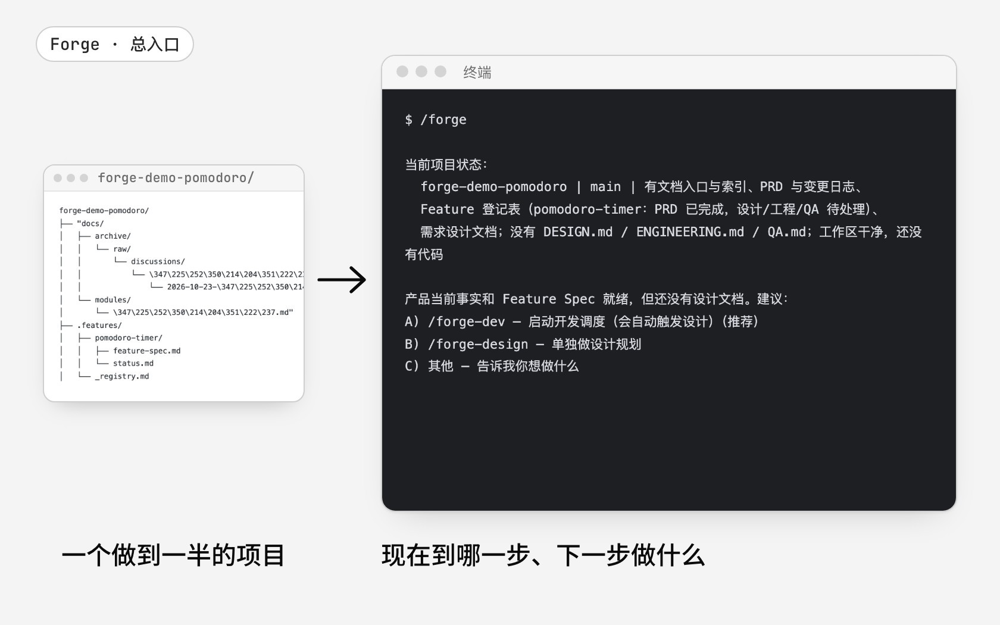</a><br><a href="SKILL.md"><b>forge</b></a> · 告诉你现在到哪、下一步做什么<br><sub>项目做到一半，常常忘了上次停在哪、下一步该用哪个工具，Forge 有十几个 Skill，新手更不知道从哪个开始。这个总入口只读不写：检查项目里有哪些文档、需求做到哪个阶段、代码和分支是什么状态，对照一张「什么状态该做什么」的表，告诉你现在到哪一步、推荐下一步用哪个 Skill。最后给出一句清楚的「下一步做这个」。</sub><br><sub><a href="examples/pomodoro/forge.md">这一步的示范记录 →</a></sub></td><td width="50%" valign="top"><a href="examples/pomodoro/forge-brainstorm.md">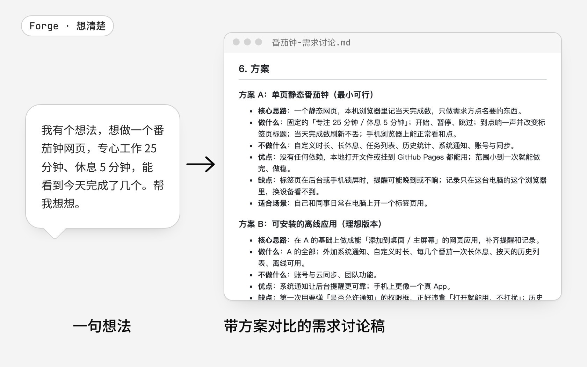</a><br><a href="skills/forge-brainstorm/"><b>forge-brainstorm</b></a> · 动手之前先把想法聊透<br><sub>有了想法直接让 AI 开写，常常做到一半才发现方向不对，而且 AI 习惯顺着你说、很少反问。这个 Skill 按产品、内容、构建、探索四种模式之一，先追问背景和真正的痛点，再挑战你的前提，强制摆出两到三个方案逐一比优缺点，最后派另一个 AI 专门挑方案的毛病；整个过程写进一份讨论文档，换台电脑也能接着聊。最后给出一份想清楚了做什么、不做什么的讨论稿。</sub><br><sub><a href="examples/pomodoro/forge-brainstorm.md">这一步的示范记录 →</a></sub></td></tr>
<tr><td width="50%" valign="top"><a href="examples/pomodoro/forge-prd.md">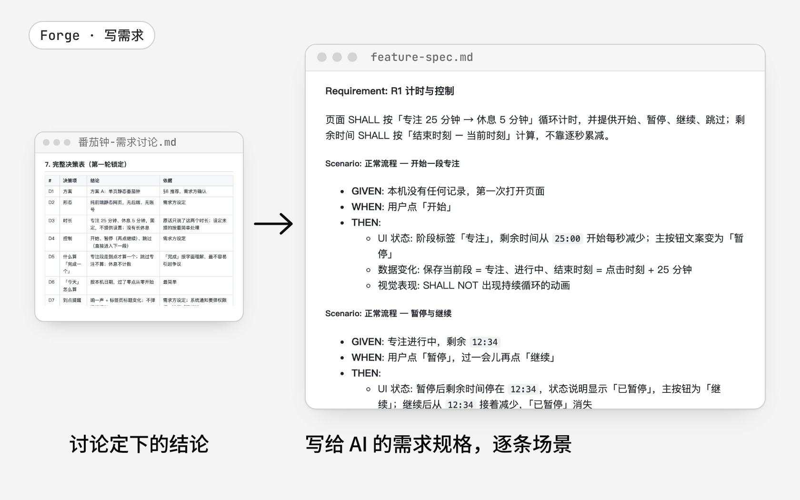</a><br><a href="skills/forge-prd/"><b>forge-prd</b></a> · 把需求写成 AI 照着做的规格<br><sub>照一段口头需求让 AI 写代码，它会自己脑补没说清的地方，做出来和你想的不一样，过后也没人记得当初为什么这么定。这个 Skill 先诊断问题出在哪（设计没想到、实现跑偏还是需求漏了），必要时反驳不合理的需求，再更新 PRD，把每个功能写成「在什么情况下、用户做什么、页面怎么变」的场景，并要求写清没数据、出错、功能降级时页面怎么表现。最后给出一份 AI 照着就能做、验收时能逐条核对的需求规格。</sub><br><sub><a href="examples/pomodoro/forge-prd.md">这一步的示范记录 →</a></sub></td><td width="50%" valign="top"><a href="examples/pomodoro/forge-feature-doc.md">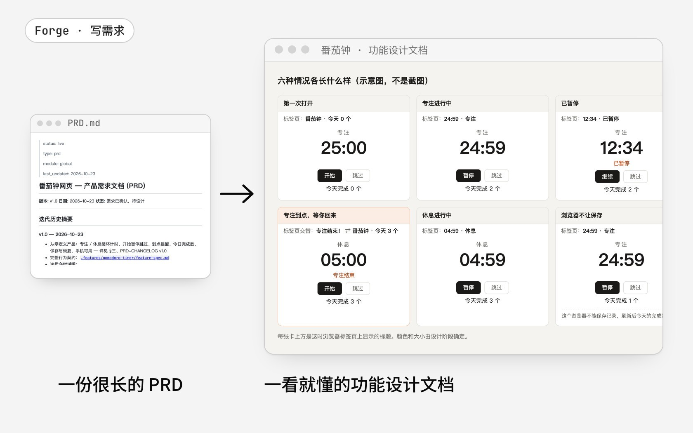</a><br><a href="skills/forge-feature-doc/"><b>forge-feature-doc</b></a> · 一份给人看的功能设计文档<br><sub>PRD 和需求规格是写给 AI 的，又长又细，老板、设计、同事看不下去，也看不出这个功能最近改了什么。这个 Skill 为每个功能维护一份给人看的设计文档：待你拍板的事放最前面，先放流程图、页面示意、各种状态的样子，再写规则和细节，只写现在的设计，末尾记关键改动；需求、规则、文案一改就跟着同步。最后给出一份几分钟能看懂、随时是最新的功能设计文档。</sub><br><sub><a href="examples/pomodoro/forge-feature-doc.md">这一步的示范记录 →</a></sub></td></tr>
<tr><td width="50%" valign="top"><a href="examples/pomodoro/forge-design.md">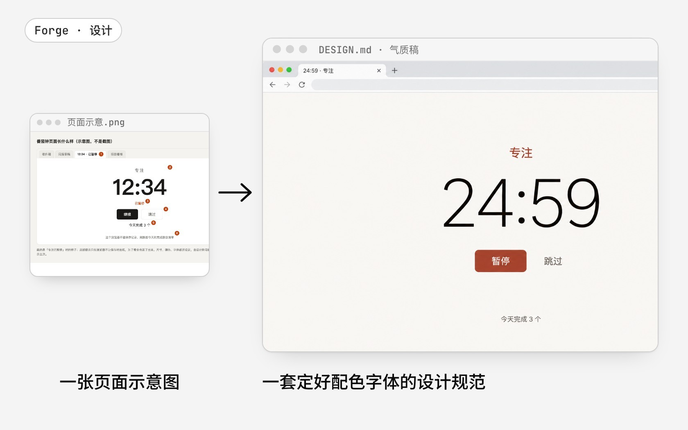</a><br><a href="skills/forge-design/"><b>forge-design</b></a> · 定下不像 AI 模板的设计规范<br><sub>让 AI 直接写页面，做出来常常是一眼就认得出的 AI 模板风：一样的渐变、一样的卡片，每个页面的颜色字号还各不相同。这个 Skill 先按改动大小分级，再查竞品、给出至少三个美学方向让你挑，从内置的配色、字体和交互规则库里选定方案，整理成一套设计变量写进 DESIGN.md，用反模板清单和打分检查，不达标就返工。最后给出一份所有页面都照着做、不像 AI 模板的设计规范。</sub><br><sub><a href="examples/pomodoro/forge-design.md">这一步的示范记录 →</a></sub></td><td width="50%" valign="top"><a href="examples/pomodoro/forge-design-lab.md">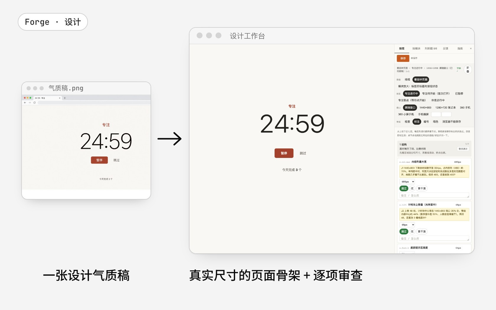</a><br><a href="skills/forge-design-lab/"><b>forge-design-lab</b></a> · 在真实尺寸的骨架上定设计<br><sub>看设计稿时觉得挺好，做出来才发现字太挤、按钮放不下、手机上被顶出屏幕，因为设计图和真实页面不是同一份东西。这个 Skill 用真实的配色、字号和像素把页面骨架画出来，可以切换各种状态和手机、电脑等屏幕尺寸，右侧面板从结构到细节分七层逐项提问，每项标出风险，你看不顺眼当场改值、当场生效，点保存就把最终的值写回设计规范和样式文件。最后给出一套写代码时直接拿来用、和你看到的完全一致的页面样式。</sub><br><sub><a href="examples/pomodoro/forge-design-lab.md">这一步的示范记录 →</a></sub></td></tr>
<tr><td width="50%" valign="top"><a href="examples/pomodoro/forge-dev.md">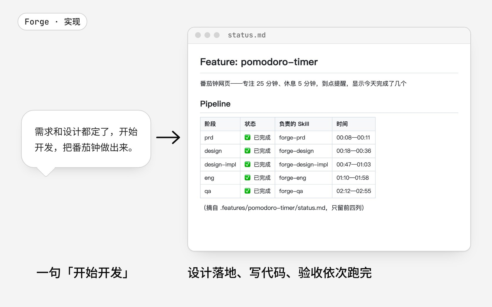</a><br><a href="skills/forge-dev/"><b>forge-dev</b></a> · 调度设计落地、写代码、验收<br><sub>让一个 AI 会话从头干到尾，对话越拉越长，前面定的规矩后面就忘了，做到一半出错也不知道该从哪接着来。这个 Skill 只当调度：读需求和设计，排好「设计落地 → 写代码 → 验收」的顺序，每一步派给一个只拿到必要文件的独立 AI 去做，自己只看结果、核对提交和截图，进度记在一张状态表里，中断了也能接着跑。最后给出一个按需求做完、验收过的功能，和一张谁做了什么的流水线表。</sub><br><sub><a href="examples/pomodoro/forge-dev.md">这一步的示范记录 →</a></sub></td><td width="50%" valign="top"><a href="examples/pomodoro/forge-design-impl.md">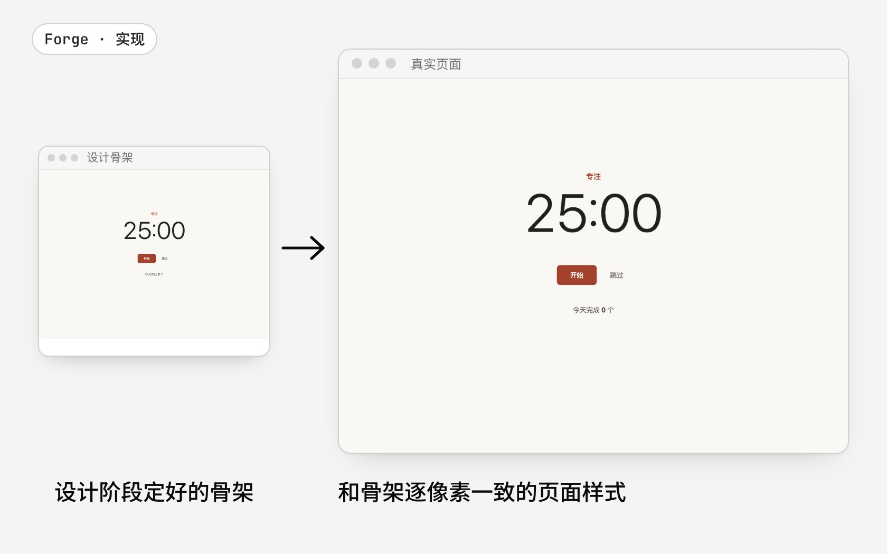</a><br><a href="skills/forge-design-impl/"><b>forge-design-impl</b></a> · 照设计骨架写出一致的页面<br><sub>设计稿交给 AI 写成页面，常常颜色、字号、间距都差一点，还会顺手加上 AI 爱用的渐变和阴影。这个 Skill 只改样式、不碰功能逻辑：所有颜色字号都从设计规范的变量里取，不许写死，对照反模板清单检查，每改一块单独提交，最后用真实截图和样式数值去核对设计。最后给出一个和设计稿看起来完全一样的页面。</sub><br><sub><a href="examples/pomodoro/forge-design-impl.md">这一步的示范记录 →</a></sub></td></tr>
<tr><td width="50%" valign="top"><a href="examples/pomodoro/forge-eng.md">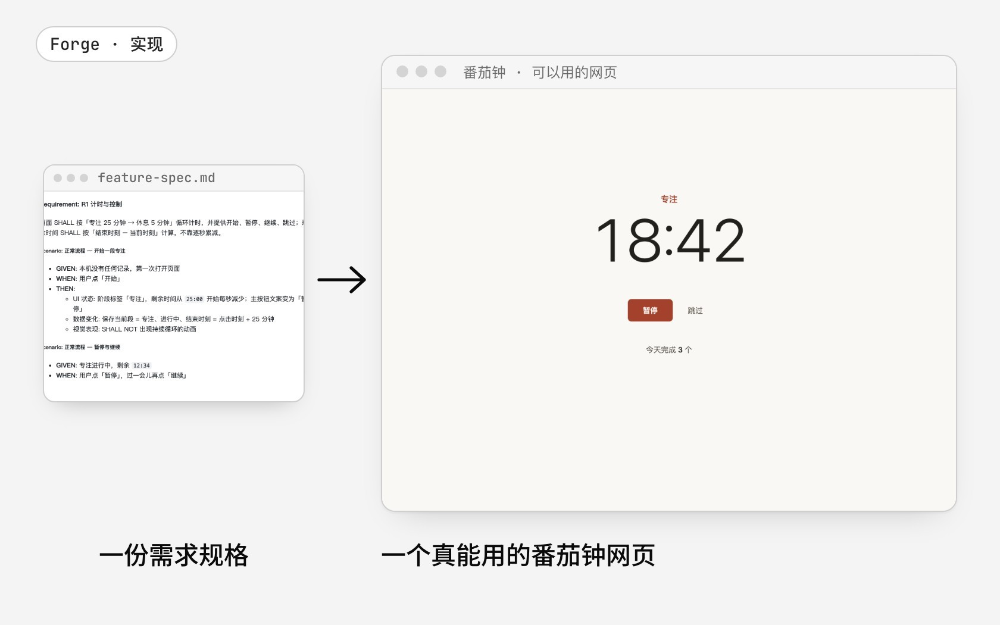</a><br><a href="skills/forge-eng/"><b>forge-eng</b></a> · 先写测试、一步一提交地写代码<br><sub>AI 写代码常常一口气改一大片，说「写好了」却没真跑过，出了问题也分不清是哪一步引入的。这个 Skill 先写工程文档、把活拆成一个个小任务，在单独的分支和工作目录里做，核心逻辑先写测试再写代码，每完成一项就拿运行结果当证据才算数，一项一个提交。最后给出一份能跑、有测试、每一步都能追溯的代码。</sub><br><sub><a href="examples/pomodoro/forge-eng.md">这一步的示范记录 →</a></sub></td><td width="50%" valign="top"><a href="examples/pomodoro/forge-qa.md">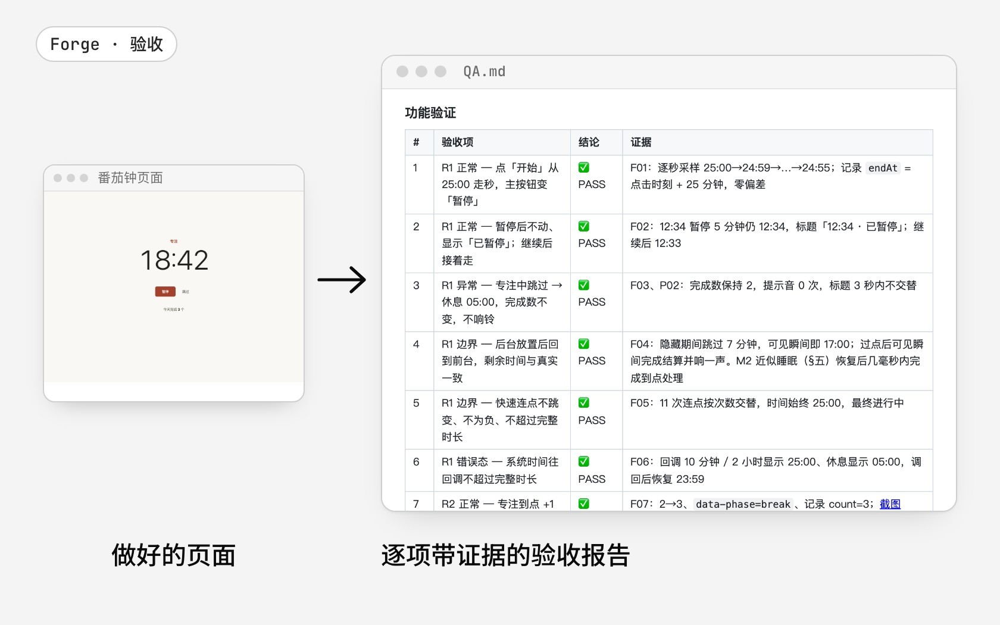</a><br><a href="skills/forge-qa/"><b>forge-qa</b></a> · 逐项带证据的验收<br><sub>AI 说「测过了」，往往只是看了一眼页面有没有出来，按钮按下去对不对、出错时显示什么都没验。这个 Skill 照需求规格的验收清单先列测试计划，用真实浏览器逐项操作，每一项都要断言具体的数据、文字和样式数值，控制台出现一个报错就算不过，测不了的写清楚交给人手动验。最后给出一份逐项带证据、拿来就能决定能不能上线的验收报告。</sub><br><sub><a href="examples/pomodoro/forge-qa.md">这一步的示范记录 →</a></sub></td></tr>
<tr><td width="50%" valign="top"><a href="examples/pomodoro/forge-review.md">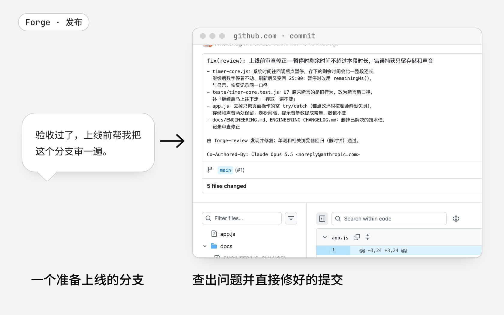</a><br><a href="skills/forge-review/"><b>forge-review</b></a> · 上线前查测试抓不到的问题<br><sub>测试全过不等于能上线：有些问题测试根本测不到，比如测试本身把错误的行为写成了「应该如此」，或者出错被悄悄吞掉、页面什么提示都没有。这个 Skill 在合并前把整个分支和主线的差异读一遍，专门找这类结构性问题（数据安全、并发、AI 输出的信任边界、遗漏的情况等），发现问题直接改，改完重跑验证。最后给出一个查过隐患、可以放心合并的分支。</sub><br><sub><a href="examples/pomodoro/forge-review.md">这一步的示范记录 →</a></sub></td><td width="50%" valign="top"><a href="examples/pomodoro/forge-ship.md">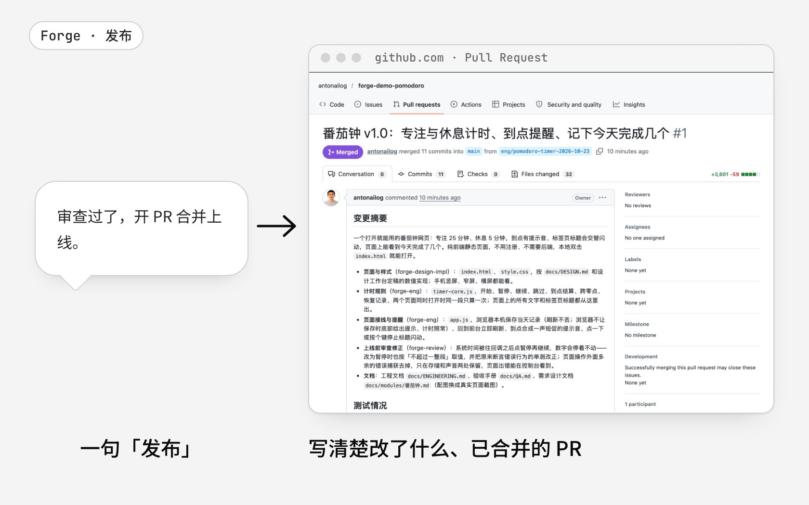</a><br><a href="skills/forge-ship/"><b>forge-ship</b></a> · 发布状态说清楚、绝不强推<br><sub>让 AI 发布，最怕它说「已上线」，其实只是提交了代码，或者测试没过就硬推、强行覆盖别人的改动。这个 Skill 先跑测试，不过就不发；开 PR 时写清改了什么、有什么风险、怎么验证；按你的选择只开 PR 或一路合并，绝不强推；汇报时把「已提交、已推送、已合并、已部署」分开说，没部署就明说没部署。最后给出一个说得清、查得到、状态不含糊的发布。</sub><br><sub><a href="examples/pomodoro/forge-ship.md">这一步的示范记录 →</a></sub></td></tr>
<tr><td width="50%" valign="top"><a href="examples/pomodoro/forge-doc-release.md">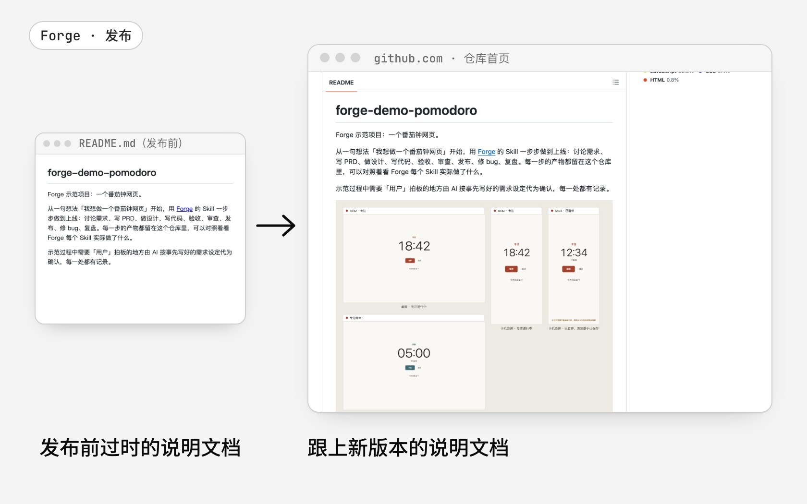</a><br><a href="skills/forge-doc-release/"><b>forge-doc-release</b></a> · 发布后让文档跟上代码<br><sub>代码上线了，说明文档还停在上个版本：README 不写怎么用，项目规则文件过时，下次 AI 开工照着旧文档做事。这个 Skill 在发布后把所有项目文档和这次的代码改动逐一对照，更新 README、项目规则和各类设计文档的状态，润色版本记录、清理已完成的待办。最后给出一套和刚上线的版本一致的文档。</sub><br><sub><a href="examples/pomodoro/forge-doc-release.md">这一步的示范记录 →</a></sub></td><td width="50%" valign="top"><a href="examples/pomodoro/forge-bugfix.md">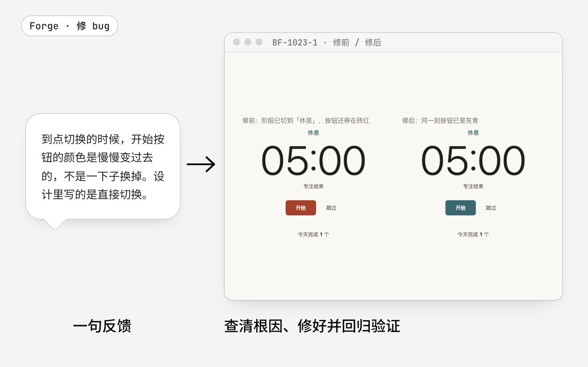</a><br><a href="skills/forge-bugfix/"><b>forge-bugfix</b></a> · 一次修一个 bug，先找根因<br><sub>跟 AI 说「这里有问题」，它常跳过找原因直接改，修好一个冒出一个，顺手还改了一堆不相干的东西。这个 Skill 一次只修一个 bug、在单独的分支里修：先复现，再用实验逐个验证猜测、讲清根因，根因和修法你点头才动手；修完让验收 Skill 回归，拿修前修后的对照当证据，你给出最终结论才合并，修的过程中发现的新问题只记下、不顺手改。最后给出一个查清原因、修好、有证据的修复。</sub><br><sub><a href="examples/pomodoro/forge-bugfix.md">这一步的示范记录 →</a></sub></td></tr>
<tr><td width="50%" valign="top"><a href="examples/pomodoro/forge-fupan.md">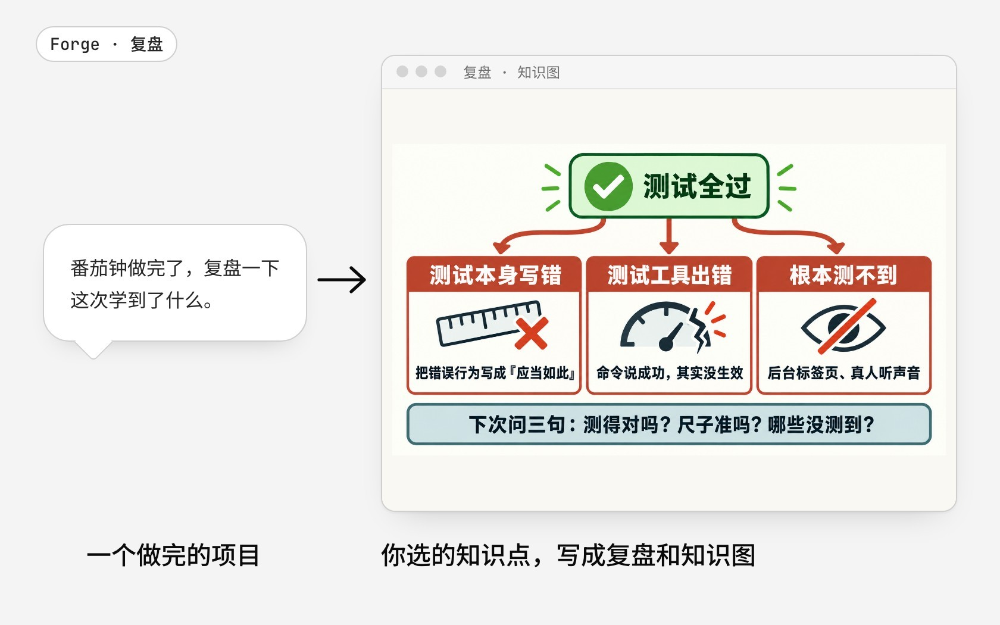</a><br><a href="skills/forge-fupan/"><b>forge-fupan</b></a> · 只复盘你想学的那几点<br><sub>项目做完就过去了，踩过的坑下次照样踩，想复盘又不知道从哪写起，写出来也是一篇没人再看的流水账。这个 Skill 先读完整个过程，列出值得学的知识点和你说得不清楚的原话，放在一个本地网页里让你勾选想学哪几个、学到什么深度，再按你的选择写复盘、画知识图，顺手记下几条教训，下次修 bug 或开发时会自动拿出来提醒。最后给出一份只讲你想学的、能复用的复盘。</sub><br><sub><a href="examples/pomodoro/forge-fupan.md">这一步的示范记录 →</a></sub></td><td width="50%" valign="top"><a href="examples/pomodoro/forge-doc-policy.md">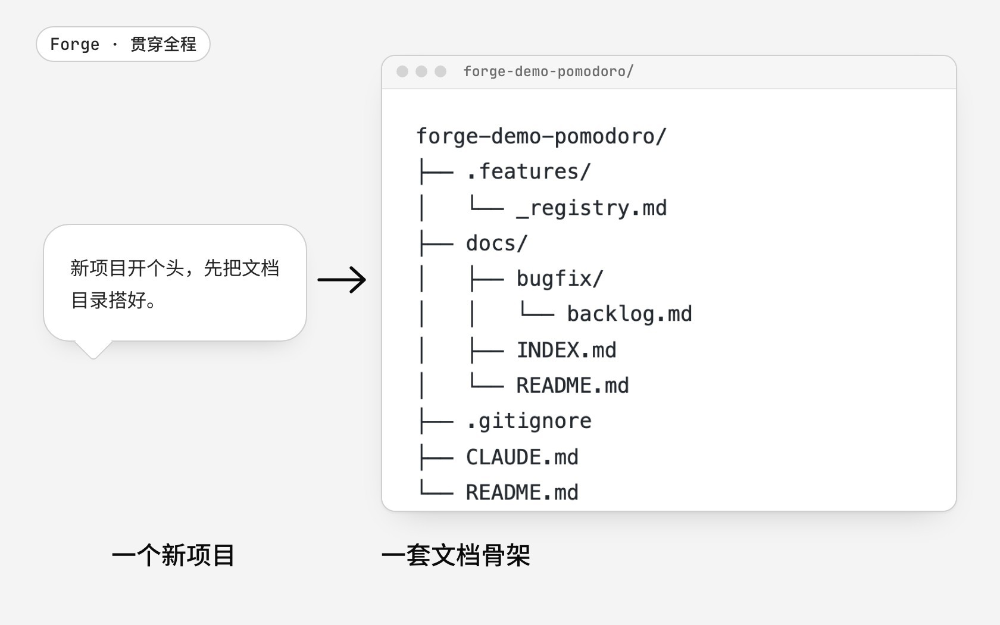</a><br><a href="skills/forge-doc-policy/"><b>forge-doc-policy</b></a> · 让每份文档各就各位<br><sub>让 AI 帮忙做项目，文档常常东一份西一份：同一件事写了好几个版本，过期的方案和现行的混在一起，下次开工 AI 读到旧的就照着做错。这个 Skill 规定每类文档该放哪（一份白名单）、开头要写清状态和类型、过期的归档到哪，新项目用一条命令搭好整套目录和索引。最后给出一个文档各就各位、人和 AI 都知道该看哪一份的项目。</sub><br><sub><a href="examples/pomodoro/forge-doc-policy.md">这一步的示范记录 →</a></sub></td></tr>
<tr><td width="50%" valign="top"><a href="examples/pomodoro/forge-status.md">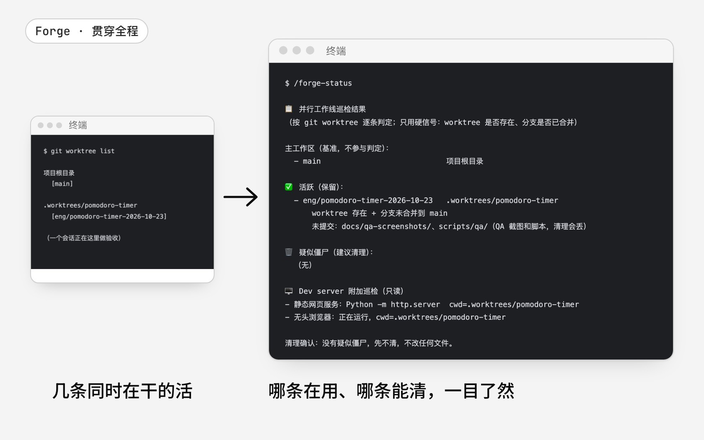</a><br><a href="skills/forge-status/"><b>forge-status</b></a> · 看清并行的几条活谁在用<br><sub>同时开好几个 AI 会话干活，过几天就分不清哪个分支还在用、哪个早就合并了可以删，误删一个还会丢掉别人没提交的改动。这个 Skill 只看硬证据：工作目录还在不在、分支有没有合并进主线，据此把每条活分成「在用」和「可以清理」，顺便列出后台在跑的服务，清理前必须你确认。最后给出一张谁在用哪块地盘、哪些能删的清单。</sub><br><sub><a href="examples/pomodoro/forge-status.md">这一步的示范记录 →</a></sub></td><td width="50%"></td></tr>
</table>

## 效果示例

### Feature Spec 确认门禁

```
用户    ❯ 帮我加一个频道管理功能

forge   ❯ ⚠️ 该功能没有 Feature Spec。建议先运行 /forge-prd 生成。

用户    ❯ /forge-prd

forge   ❯ Feature Spec 已生成，请审阅：
          一、用户流程：设置页 → 频道列表 → 添加/删除/排序 → 保存
          二、页面结构：3 个区块，5 个组件
          三、行为场景：3 个功能点，共 9 个 Given/When/Then 场景
          四、验收检查表：18 项（功能 9 + 视觉 6 + 流程 3）
          
          A) 确认，进入开发
          B) 整体方向需要调整
          C) 细节需要修改
```

### 举一反三

```
用户    ❯ 频道卡片的间距不对，应该是 16px 不是 12px

forge   ❯ 已修复。搜索代码库发现 3 处类似风险：
          1. src/components/SourceCard.tsx:42 — 同样使用 gap-3（12px）
          2. src/components/ActionCard.tsx:28 — padding 也是 12px
          3. Feature Spec 中 StarredView 组件要求 gap: 16px，当前为 12px
          
          要一并修复吗？
          A) 全部修复
          B) 选择性修复
```

---

## Skill 清单

### 核心链路（9 个）

| 阶段 | Skill | 命令 | 职责 | 产出 |
|------|-------|------|------|------|
| 讨论 | forge-brainstorm | `/forge-brainstorm` | 头脑风暴（4 模式 · 6 阶段 · 反谄媚 · 对抗性审查） | 思考文档 |
| 需求 | forge-prd | `/forge-prd` | 产品诊断 + Feature Spec 生成 | PRD.md + .features/feature-spec.md |
| 调度 | forge-dev | `/forge-dev` | 开发调度器，编排子技能；`--full` 一路到发布 | CONTEXT.md + RESEARCH.md + .forge/ 检查点 |
| 设计 | forge-design | `/forge-design` | 全栈设计（竞品 + 美学 + Token + UX 规则 + 评分） | DESIGN.md |
| 设计工作台 | forge-design-lab | `/forge-design-lab` | 真 token 真像素骨架上定布局/密度（七层审查 + 保存直写 + token 同源导出） | 页面包 + tokens.css + DESIGN.md token 表 |
| 设计实现 | forge-design-impl | `/forge-design-impl` | 设计转代码（反 AI 模板 + Token 驱动 + 原子提交） | 样式代码 |
| 工程 | forge-eng | `/forge-eng` | 工程实现（Worktree + TDD + 逐场景自验） | ENGINEERING.md + 代码 |
| QA | forge-qa | `/forge-qa` | 验收计划 → 测试 → 报告 → 举一反三（只测不修） | QA 验收报告 |
| 审查 | forge-review | `/forge-review` | 代码审查（测试捕获不到的结构性问题） | 审查结论 + 修复 |
| 发布 | forge-ship | `/forge-ship` | 合并 + 测试 + CHANGELOG + PR | PR / 合并上线 |

### 辅助技能（6 个）

| Skill | 命令 | 职责 |
|-------|------|------|
| forge-bugfix | `/forge-bugfix` | 系统性 Bug 修复流水线（P0-P8：根因铁律 + 独立 worktree + TDD + 双层验收 + 多会话防撞车） |
| forge-status | `/forge-status` | 并行会话巡检与清理（扫 `.forge/active.md`，按硬信号判活/死，不用时间戳启发式） |
| forge-doc-release | `/forge-doc-release` | 发布后文档同步（README/ARCHITECTURE/CHANGELOG 对齐已发布内容） |
| forge-doc-policy | `/forge-doc-policy` | 文档治理规范（doc-paths.md 真相源白名单 + frontmatter schema + init-project.sh 脚手架） |
| forge-feature-doc | `/forge-feature-doc` | 需求设计文档：每个功能一份给人看的设计文档（待拍板置顶、先图后字、只写当前设计、末尾关键改动），配出图脚本和上线前检查；forge 各阶段收尾时同步，review / ship 当门禁 |
| forge-fupan | `/forge-fupan` | 复盘 v3：Workbench 门禁（独立会话页确认知识点和深度）→ 调研产出复盘文档；账本（learnings.jsonl）作副产出，开工回放 + 复发检测 |

### 每个 Skill 怎么运转

每个 Skill 一张结构图：阶段、门禁、回退和产出。点图进 Skill 目录，看说明和完整的 SKILL.md。

<table>
<tr><td width="50%" valign="top"><a href="skills/forge-brainstorm/">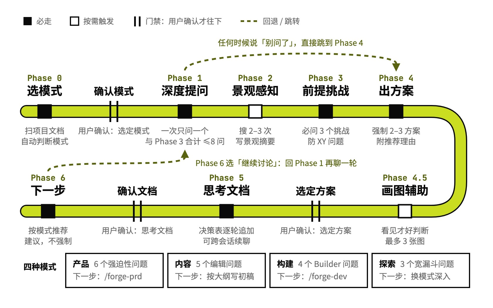</a><br><a href="skills/forge-brainstorm/"><b>forge-brainstorm</b></a> · 头脑风暴：先挑战前提，再给 2—3 个方案</td><td width="50%" valign="top"><a href="skills/forge-prd/">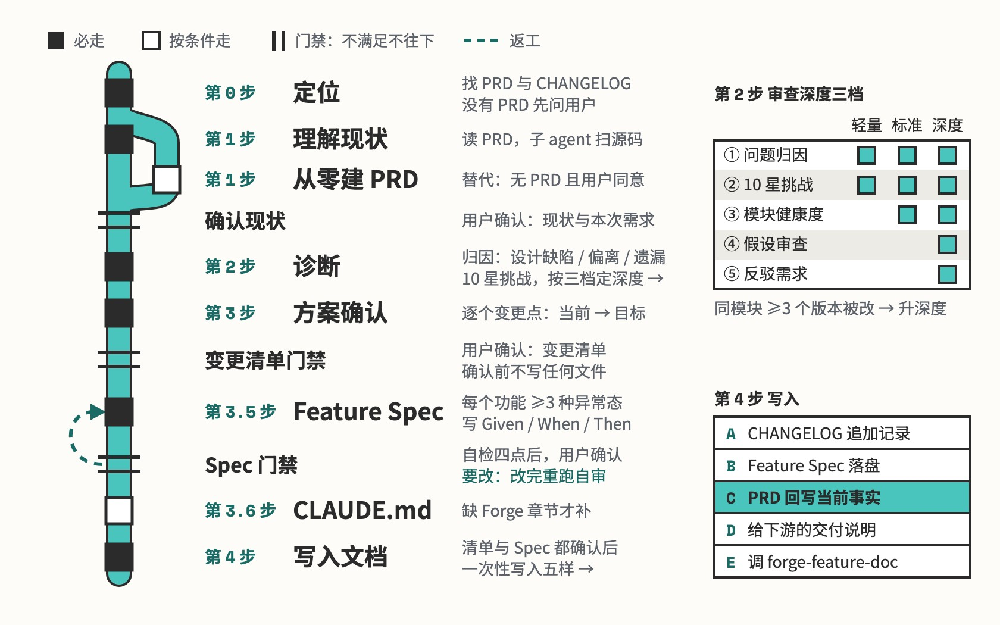</a><br><a href="skills/forge-prd/"><b>forge-prd</b></a> · 诊断问题、改 PRD、出 Feature Spec</td></tr>
<tr><td width="50%" valign="top"><a href="skills/forge-feature-doc/">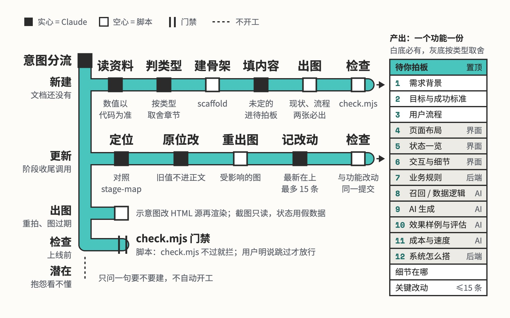</a><br><a href="skills/forge-feature-doc/"><b>forge-feature-doc</b></a> · 每个功能一份给人看的设计文档</td><td width="50%" valign="top"><a href="skills/forge-design/">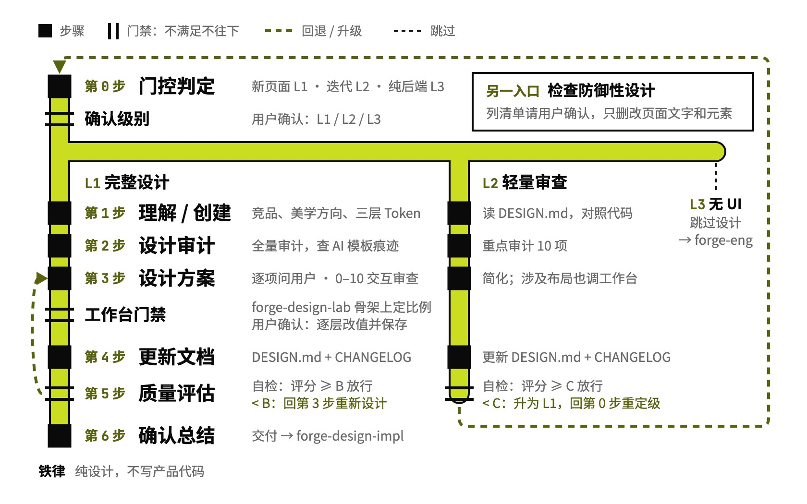</a><br><a href="skills/forge-design/"><b>forge-design</b></a> · 管 DESIGN.md 和设计规则库</td></tr>
<tr><td width="50%" valign="top"><a href="skills/forge-design-lab/">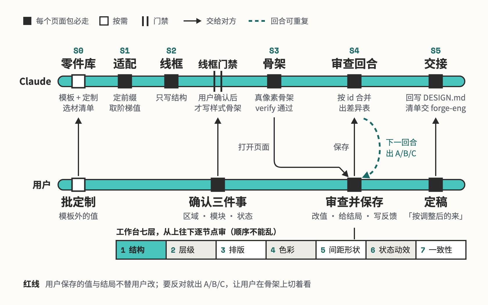</a><br><a href="skills/forge-design-lab/"><b>forge-design-lab</b></a> · 在真 token 的骨架上定布局和密度</td><td width="50%" valign="top"><a href="skills/forge-design-impl/">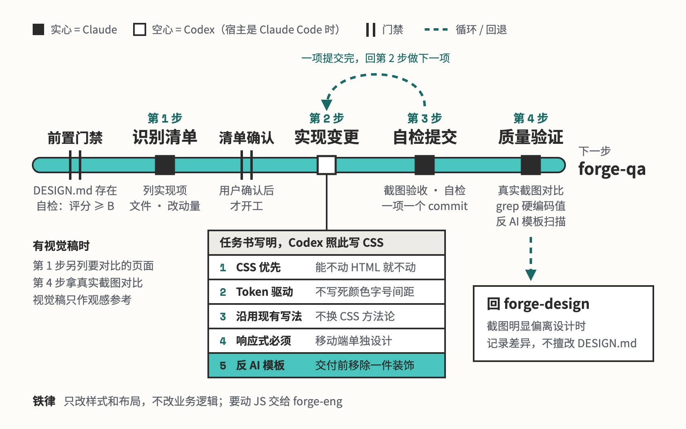</a><br><a href="skills/forge-design-impl/"><b>forge-design-impl</b></a> · 把设计文档落成 CSS</td></tr>
<tr><td width="50%" valign="top"><a href="skills/forge-dev/">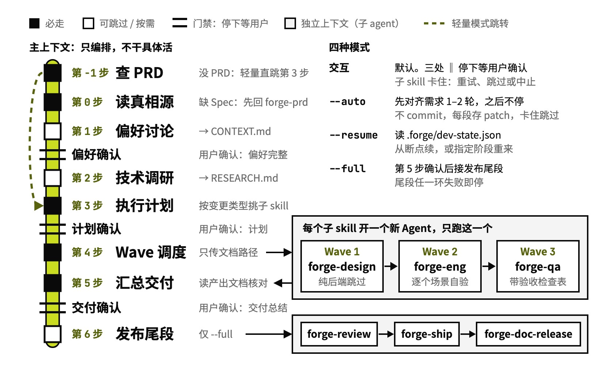</a><br><a href="skills/forge-dev/"><b>forge-dev</b></a> · 开发调度：子 Skill 各开上下文</td><td width="50%" valign="top"><a href="skills/forge-eng/">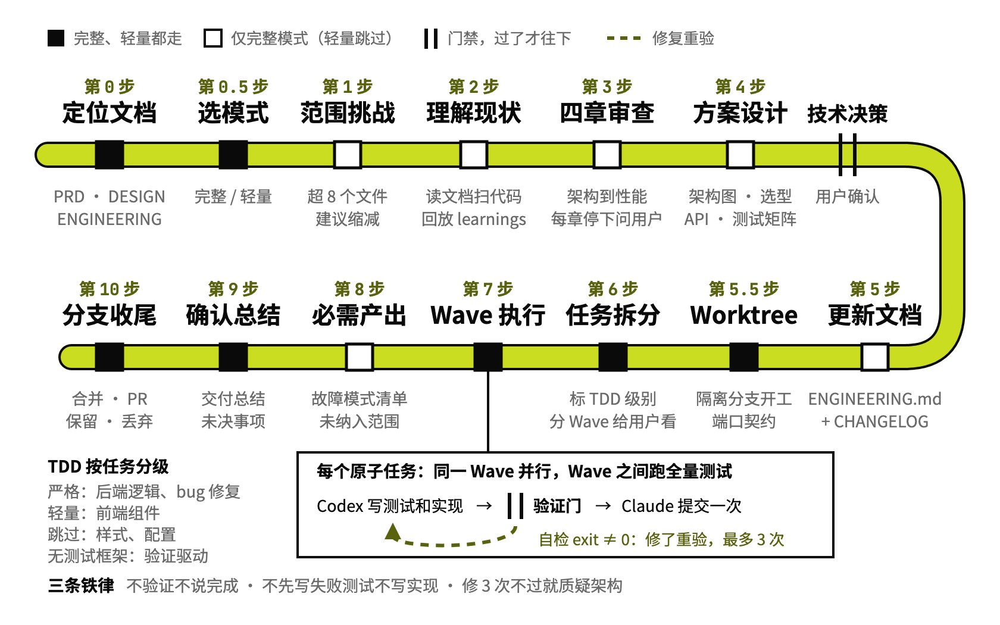</a><br><a href="skills/forge-eng/"><b>forge-eng</b></a> · 工程实现：worktree 隔离、分级 TDD</td></tr>
<tr><td width="50%" valign="top"><a href="skills/forge-qa/">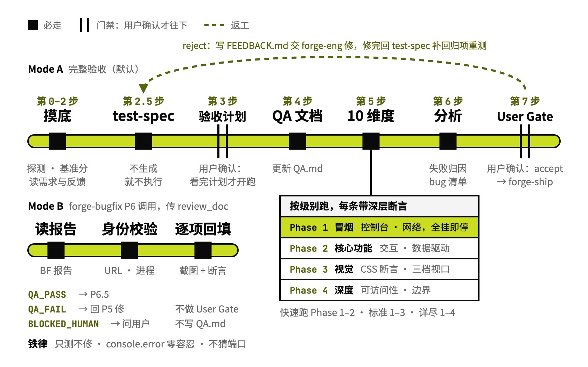</a><br><a href="skills/forge-qa/"><b>forge-qa</b></a> · 只测不修的验收</td><td width="50%" valign="top"><a href="skills/forge-review/">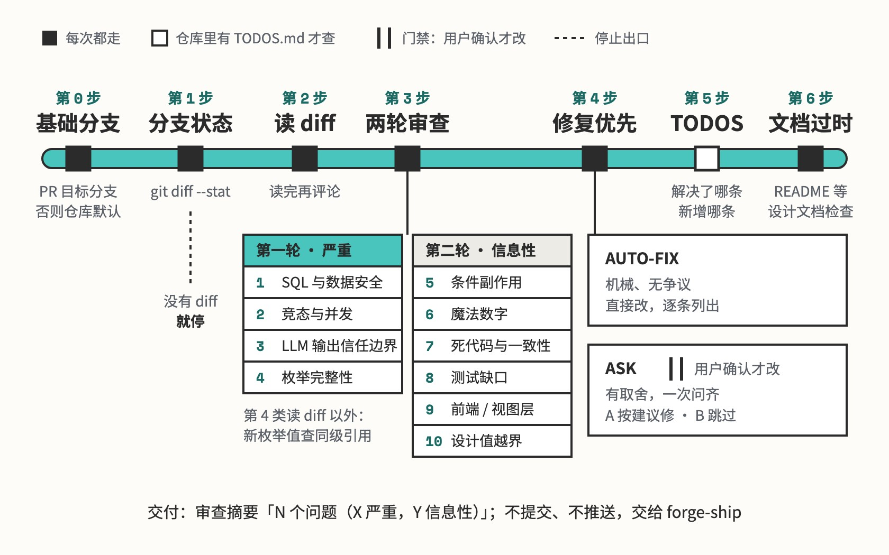</a><br><a href="skills/forge-review/"><b>forge-review</b></a> · 上线前的结构性审查</td></tr>
<tr><td width="50%" valign="top"><a href="skills/forge-ship/">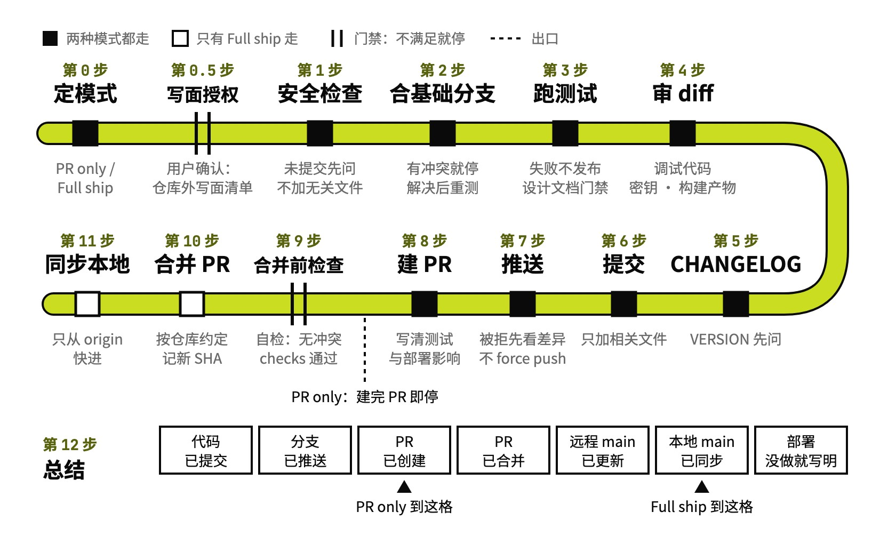</a><br><a href="skills/forge-ship/"><b>forge-ship</b></a> · 建 PR、合并、同步主分支</td><td width="50%" valign="top"><a href="skills/forge-doc-release/">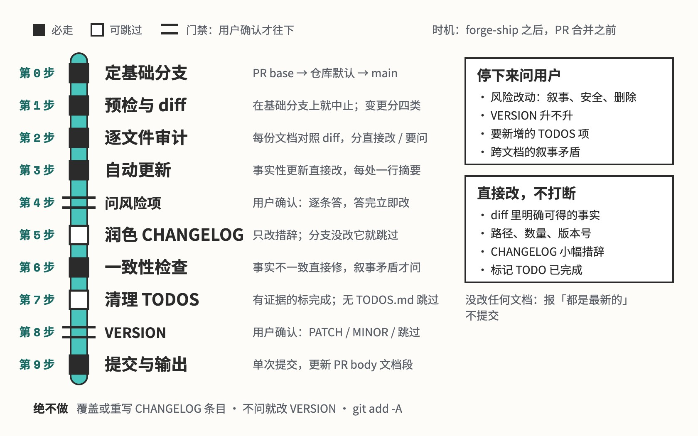</a><br><a href="skills/forge-doc-release/"><b>forge-doc-release</b></a> · 发布后同步 README、CHANGELOG</td></tr>
<tr><td width="50%" valign="top"><a href="skills/forge-fupan/">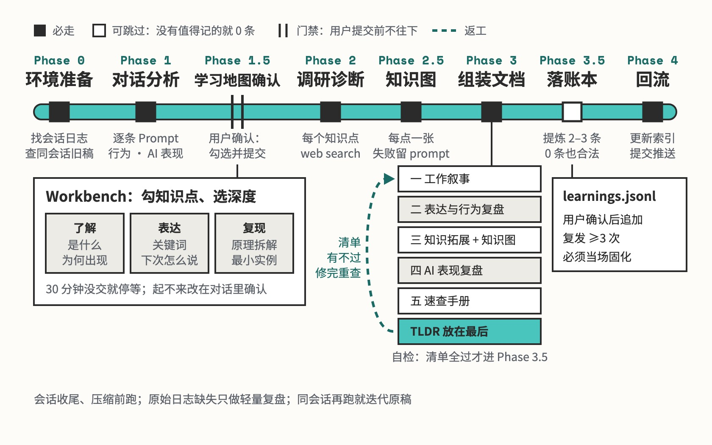</a><br><a href="skills/forge-fupan/"><b>forge-fupan</b></a> · 复盘工作台，产出复盘文档和知识图</td><td width="50%" valign="top"><a href="skills/forge-bugfix/">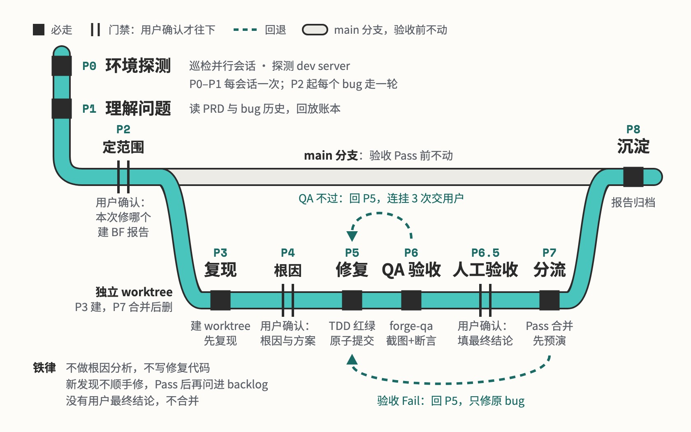</a><br><a href="skills/forge-bugfix/"><b>forge-bugfix</b></a> · 一次修一个：先根因，再写代码</td></tr>
<tr><td width="50%" valign="top"><a href="skills/forge-status/">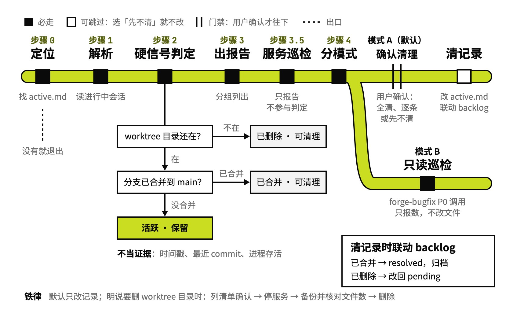</a><br><a href="skills/forge-status/"><b>forge-status</b></a> · 并行会话巡检与清理</td><td width="50%" valign="top"><a href="skills/forge-doc-policy/">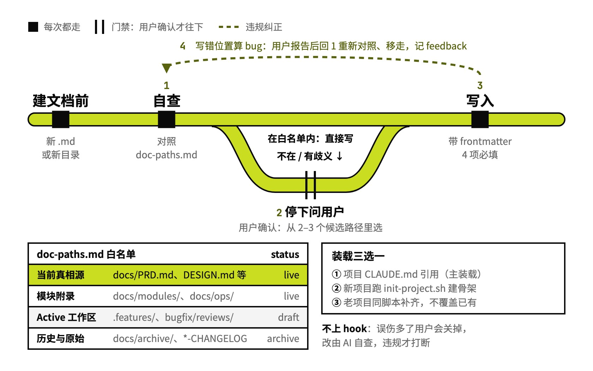</a><br><a href="skills/forge-doc-policy/"><b>forge-doc-policy</b></a> · 文档放哪、怎么标生命周期</td></tr>
</table>

### 总入口

```
/forge  →  检查项目状态（.features/、git branch、文档），推荐下一步
```

### 共享层

`skills/_shared/` 存放被多个 Skill 引用的公共规范，随 install.sh 一起 symlink，各 Skill 只写一行引用、不复制内容（单源防漂移）：

| 文件 | 内容 |
|------|------|
| `interaction-protocol.md` | AskUserQuestion 提问格式 + 全体系统一批量策略（≤3 单独问，>3 同类批量） |
| `feature-status-protocol.md` | `.features/` 状态标记（⏳🔄✅❌⏸️）+ 通用操作规则 |
| `current-doc-loading.md` | 当前文档加载契约（真相源优先，changelog/archive 按需） |
| `visual-decision-layer.md` | 视觉决策层：结构问题优先 Mermaid，气质判断用 Image 2，验收只认真实截图 + CSS 断言；复盘默认不配图 |

---

## 关键机制

### Feature Spec（规范驱动）

每个功能在开发前**必须**有 Feature Spec。完整 Spec 写入 `.features/{feature-id}/feature-spec.md`；`docs/PRD.md` 保持为产品当前真相源，只吸收已确认且仍有效的产品事实。

| 章节 | 内容 | 服务于 |
|------|------|--------|
| 用户流程总览 | 入口 → 步骤 → 出口（含异常分支） | 用户确认整体方向 |
| 页面/系统结构 | 全局布局 → 区块职责 → 组件清单 + CSS 约束 | 用户确认结构 |
| 行为场景 | Given/When/Then × 3（正常/异常/边界） | 开发对标 + QA 断言 |
| 验收检查表 | 功能验证 + 视觉合规（含 CSS 值）+ 流程完整性 | QA 直接用作测试用例 |

### 规范驱动规则（R1-R7）

写入项目 CLAUDE.md，每次会话自动加载：

| 规则 | 内容 |
|------|------|
| **R1** | 无 Feature Spec 不写代码 |
| **R2** | 实现严格对标文档，逐场景自验 Given/When/Then |
| **R3** | 视觉实现对标 DESIGN.md，CSS 值必须一致 |
| **R4** | QA 基于验收检查表断言，含具体 CSS 属性值检查 |
| **R5** | 收到反馈时举一反三（搜索相似模式 + 类似风险清单） |
| **R6** | 提交前自验所有相关场景 |
| **R7** | 声称完成时提供验证证据 |

### 上下文工程

解决 AI 长会话质量劣化（Context Rot）问题：

```
forge-dev（调度器，~30% 上下文）     forge-eng（执行器，100% 全新上下文）
┌─────────────────────┐           ┌──────────────────────────┐
│ PRD 摘要             │  Agent    │ ENGINEERING.md 全文       │
│ RESEARCH.md 摘要     │ ───────→ │ .features Feature Spec 行为场景 │
│ 执行计划             │  传递路径  │ 源代码（按需读取）         │
└─────────────────────┘           └──────────────────────────┘
```

同一思路贯穿全体系：每个 SKILL.md 只保留骨架和铁律，阶段细则拆进 `references/` 按需加载（如 forge-bugfix 63KB → 12.6KB 骨架 + 4 份阶段手册）。2026-07-17 对标 Anthropic skill-creator 与 yao-meta-skill 完成两轮整改后，15 个 SKILL.md 总量累计下降 22%（4429→3449 行），最大文件 332 行，全部远离官方 500 行红线；触发路由用 `evals/trigger-cases.md` 回归。

### 复盘闭环（能力复利）

```
forge-fupan 产出账本条目（learnings.jsonl，含置信度）
       │
       ▼
下次开工：forge-bugfix P1 / forge-eng 理解现状 自动回放相关条目
       │
       ▼
再复盘：检测同类问题复发 → 复发 ≥3 次强制固化为 skill 规则
```

---

## 安装

```bash
# 克隆到本地
git clone https://github.com/antonailog/forge-skills.git

# 运行安装脚本（默认同时安装到 Claude Code 和 Codex 可发现目录）
cd forge-skills
./install.sh

# 新开 Claude Code / Codex 会话即可使用
```

常用选项：

```bash
./install.sh --uninstall      # 卸载（移除 symlink）
./install.sh --target claude  # 仅 ~/.claude/skills
./install.sh --target codex   # 仅 ~/.agents/skills
./install.sh --status         # 检查当前 symlink 是否完整（含坏链检测）
./install.sh --dry-run        # 只打印动作，不改文件
```

安装方式是 **symlink 而非复制**：`skills/` 目录是唯一真源，`git pull` 后所有会话立即用上新版本，不会产生漂移的副本。

**forge-design-lab 另需 [design-studio](https://github.com/antonailog/design-studio)**（工作台服务和 token 工具在那里）：`git clone https://github.com/antonailog/design-studio.git ~/.design-studio`，`install.sh` 会检测并提示。它是独立仓库，要单独 `git pull` 更新。skill 清单自动发现（`skills/` 下含 SKILL.md 的目录），新增 skill 无需改安装脚本。

---

## 设计哲学

1. **讨论是最便宜的修复** — 充分讨论 → 充分设计 → 才写代码
2. **文档是源代码的上游** — PRD 变更驱动代码变更，不是反过来
3. **规范驱动开发** — Feature Spec（Given/When/Then）是行为契约，无 Spec 不写代码
4. **上下文是最稀缺的资源** — 调度器精简（30%），子任务独立上下文（100%），骨架 + references 按需加载
5. **证据先于断言** — TDD + Verification Gate，声称完成须提供证据
6. **用户保持控制权** — Feature Spec、验收计划、举一反三——关键决策交用户
7. **举一反三** — 发现问题后搜索相似模式，不仅修单点
8. **原子化一切** — 每个任务独立 commit，可追溯、可回滚
9. **复盘闭环** — 教训进账本 → 开工回放 → 复发检测 → 反哺 Skill，下次更好

---

## 文档导航

| 文档 | 内容 |
|------|------|
| [forge-user-guide.md](docs/forge-user-guide.md) | 使用指南 — 架构图、Skill 详解、工作流模式 |
| [architecture.md](docs/architecture.md) | 架构设计 — 上下文工程、分层架构、状态管理 |
| [workflow-guide.md](docs/workflow-guide.md) | 工作流 — 场景选择、最佳实践、常见问题 |
| [skills-reference.md](docs/skills-reference.md) | 技能手册 — 每个 Skill 的完整机制和产出 |
| [glossary.md](docs/glossary.md) | 术语词典 — 关键概念中英对照 |
| [releases/](docs/releases/) | 发布说明 — 各版本详细变更（最新：[v2026.07.17](docs/releases/v2026.07.17.md)） |
| [openspec-research.md](docs/archive/openspec-research.md) | OpenSpec 调研 — Given/When/Then 思想来源 |

<details>
<summary>更多文档（历史分析与审计）</summary>

| 文档 | 内容 |
|------|------|
| [skill-audit-2026-07.md](docs/archive/skill-audit-2026-07.md) | 2026-07 逐 skill 深度审计（P-01~P-30） |
| [skill-review-2026-07-17.md](docs/archive/skill-review-2026-07-17.md) | 2026-07-17 外部对标审查（skill-creator + yao-meta-skill） |
| [external-tools-analysis.md](docs/archive/external-tools-analysis.md) | 外部工具分析 — Superpowers/gstack/CKM 能力拆解 |
| [superpowers-comparison.md](docs/archive/superpowers-comparison.md) | Superpowers 对照 — 融合对比与完成状态 |
| [design-skill-fusion-methodology.md](docs/design-skill-fusion-methodology.md) | 设计 Skill 融合方法论 |
| [forge-deliver-analysis.md](docs/archive/forge-deliver-analysis.md) | forge-deliver 重写分析 — v1 vs v2 对比 |

</details>

---

## 仓库结构

```
forge-skills/
├── README.md                       ← 你在这里
├── SKILL.md                        ← /forge 总入口
├── CHANGELOG.md                    ← 版本变更账本
├── LICENSE                         ← MIT
├── install.sh                      ← 一键安装/卸载（symlink，自动发现 skill）
├── skills/                         ← 16 个专职 Skill + 共享层
│   ├── _shared/                    ←   跨 skill 公共规范（文档加载协议、视觉决策层）
│   ├── forge-brainstorm/           ←   头脑风暴
│   ├── forge-prd/                  ←   PRD 当前事实 + .features Feature Spec
│   ├── forge-dev/                  ←   开发调度器（--full 端到端）
│   ├── forge-design/               ←   设计规划（含 UX 规则/配色/字体数据库）
│   ├── forge-design-lab/           ←   设计工作台（真比例骨架 + 七层审查 + token 同源）
│   ├── forge-design-impl/          ←   设计实现
│   ├── forge-eng/                  ←   工程实现（Worktree + TDD）
│   ├── forge-qa/                   ←   QA 验收（只测不修）
│   ├── forge-bugfix/               ←   Bug 修复流水线（P0-P8）
│   ├── forge-review/               ←   PR 审查
│   ├── forge-ship/                 ←   发布
│   ├── forge-doc-release/          ←   发布后文档更新
│   ├── forge-doc-policy/           ←   文档治理规范 + init 脚手架
│   ├── forge-feature-doc/          ←   需求设计文档（每功能一份给人看 + 出图 + 上线前检查）
│   ├── forge-status/               ←   并行会话巡检
│   └── forge-fupan/                ←   复盘（Workbench 门禁 + 账本副产出）
│       └── */references/           ←   各 skill 的阶段手册（按需加载）
├── tools/
│   └── fupan-workbench/            ← 复盘工作台应用（复盘流程门禁 + 历史回看，不随 skill 加载）
├── evals/
│   └── trigger-cases.md            ← 触发路由回归用例（改 description 后过一遍）
├── _archive/                       ← 退役 skill（含 forge-deliver）
├── docs/                           ← 文档
└── assets/                         ← 架构图（SVG）
```

---

## 融合来源

Forge 融合了以下框架的精华：

| 来源 | 整合了什么 |
|------|-----------|
| **OpenSpec** | Given/When/Then 行为场景、SHALL/MUST 措辞规范（思想，非工具链） |
| **Superpowers** | Worktree 隔离、TDD 红绿重构、Verification Gate、对抗性审查、Spec 四点自审 |
| **gstack office-hours** | 6 个强迫性问题、反谄媚规则、Pushback 模板 |
| **gstack plan-ceo-review** | 梦想状态映射、反转思维、最窄楔子 |
| **gstack /learn + /retro** | 复盘账本（append-only + 置信度 + 复发检测）思路 |
| **ui-ux-pro-max** | 99 条 UX 规则、配色/字体搜索引擎 |
| **design-consultation** | 竞品调研、美学方向探索 |
| **frontend-design** | 反 AI-slop 方法论 |
| **ckm-design-system** | 三层 Token 架构 |

---

<div align="center">

MIT License &copy; [antonailog](https://github.com/antonailog)

</div>
