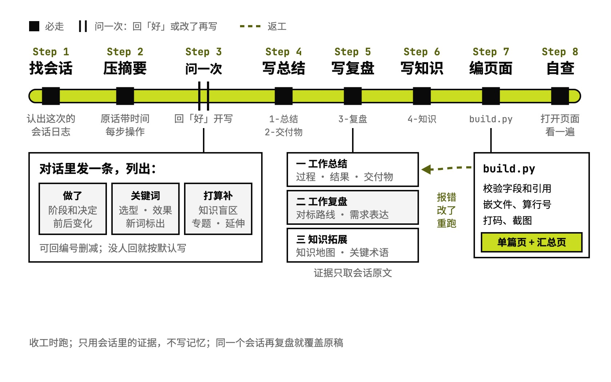

# forge-fupan

收工复盘：做了什么、差在哪、补什么

## 要解决的问题

一次 AI 协作做完，值得带走的有三样：这次到底做成了什么，哪一步和业内做法差得远，自己缺了哪些知识，所以指挥不动 AI。让 AI 随手写个总结，往往是一长段流水账，名词密，数字凭印象，看完还是说不出下次该怎么改。复盘写完散在各处，过几周想找回某一次，只能翻文件名猜。

## 运行方式



收工时跑。当前会话只做调度，写复盘交给一个从零读日志的执行方，默认是 Codex，也可以换成 Claude 子 agent。执行方先找到这次的会话日志，压成带原话和时间的摘要，再写一条启动消息，列出做了什么、关键词和打算补的知识；当前会话把它原样转给你，你回「好」就接着写，没人回就按默认写。三节写成结构化数据，校验通过后编成单篇页面，再重建汇总页。最后当前会话重编一次、截图，查引用的原话和外链，没问题才交给你。

## 关键设计

一次复盘要同时做到三件事：讲清这次做了什么，对照业内做法看差在哪，按这次暴露的问题补知识。forge-fupan 把它们分成三节：工作总结、工作复盘、知识拓展。AI 只写结构化数据，脚本负责校验、打码、编页面。所有复盘共用一个阅读页，按项目和模块归进汇总页。

- **结论都从会话里来**：`scripts/digest.py` 把会话日志压成带北京时间的原话和每一步操作，复盘里的原话、数字和时间都从这里取。决策按谁提出、谁拍板分成八类来源，判定顺序写在 `references/write-overview.md`。
- **对照业内最佳路径**：`references/write-review.md` 规定先列出这类工作的标准步骤，再逐步判一致、合理偏离、待改进、缺失。每一步给一句能直接复制给 AI 的「下次这样说」，引用的外链逐个打开核对。
- **按会话证据补知识**：`references/write-knowledge.md` 从问过、没想到、说不出、判断不了这几类证据里找知识盲区，补到能指挥和判断 AI 为止。盲区挂在这件事的组成部分上，画成知识地图；关键词按领域收进关键术语。
- **AI 写数据，脚本出页面**：AI 写四份 JSON，`scripts/build.py` 校验字段和互相引用，嵌进文件内容、按函数算行号，自动打码密钥和 IP，再截图，编成单篇数据。所有复盘共用一份阅读页 `assets/reader.html`。
- **写复盘交给执行方**：在跑了很久的会话里原地写，每次请求都带着整个会话的上下文。`references/dispatch.md` 规定当前会话只定范围、转话和验收，写交给从零读日志的执行方：默认经 codex-delegate 派给 Codex，第一段写好启动消息就停，拿到你的回复再续写；返工两轮不过就换另一个执行方接手。`scripts/check_quotes.py` 把复盘里引用的原话拿到日志里查，只列搜不到的。
- **经验库、知识库跟着长**：写复盘时用 `build.py --catalog` 查编号，认领这次对应的经验（`review.sops`，每步一句这次的真事），给知识条目和关键术语标知识库编号（`kb`）。`scripts/workbench.py` 校验后写进经验库、知识库：经验底部加这篇，知识点加出处，对不上的进经验候选、知识待归位。汇总页成了工作台，顶上切换复盘、经验、知识三页。没有经验库、知识库就只出复盘页
- **按项目和模块找得回来**：汇总页默认按时间列出最近的复盘，每篇两行，写起因、做法和结果；点开某个项目，能看到各模块最近一次做到了哪里。

```text
forge-fupan/
├── SKILL.md                  流程、产出位置、红线
├── references/
│   ├── dispatch.md           派给执行方、转话、验收
│   ├── startup.md            动笔前在对话里问的那一条
│   ├── schema.md             四份 JSON 的字段和例子
│   ├── write-overview.md     一、工作总结怎么写
│   ├── write-review.md       二、工作复盘怎么写
│   └── write-knowledge.md    三、知识拓展怎么写
├── scripts/
│   ├── find_session.py       找到这次的会话日志
│   ├── digest.py             会话日志压成摘要
│   ├── build.py              校验、编页面、重建工作台、列编号（--catalog）
│   ├── workbench.py          经验、知识两页的数据；认领经验和知识编号的校验、写入
│   └── check_quotes.py       验收时查引用的原话
└── assets/
    ├── reader.html           单篇、汇总、经验、知识共用的阅读页
    └── icons.json            关键术语能用的图标名单
```

## 其他

- 前提：Python 3.9 以上；默认交给 Codex 写，要装 Codex CLI 和 [codex-delegate](https://github.com/antonailog/skills/tree/main/skills/codex-delegate)，没装就由 Claude 子 agent 写；结果截图要装 Playwright，截不了图就只放链接；改阅读页要 Node，源码在仓库的 `tools/fupan-reader/`
- 注意：复盘根目录默认是作者工作区的 `记录/复盘/`，换环境时设环境变量 `FUPAN_ROOT`
- 注意：经验库、知识库默认在复盘根上两级的 `知识/知识图谱/2-结果区/`，换位置设 `FUPAN_KB`；没有就只出复盘页
- 注意：同一个会话再复盘，会覆盖原来那个文件夹
- 注意：以前按时间写的 md 复盘原样保留，它们的模块和两行描述写在复盘根目录的 `旧复盘描述.json`

---

完整指令见 [SKILL.md](SKILL.md)；安装方法见仓库首页的 [README](../../README.md)。
